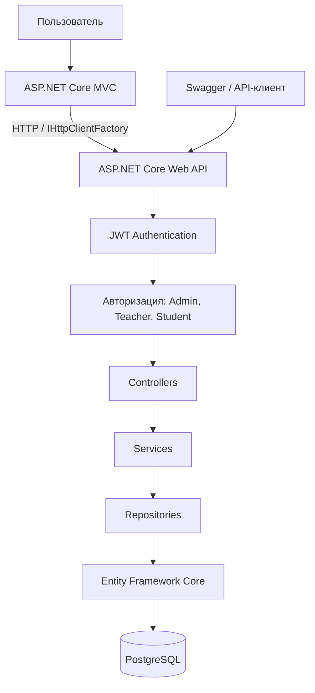
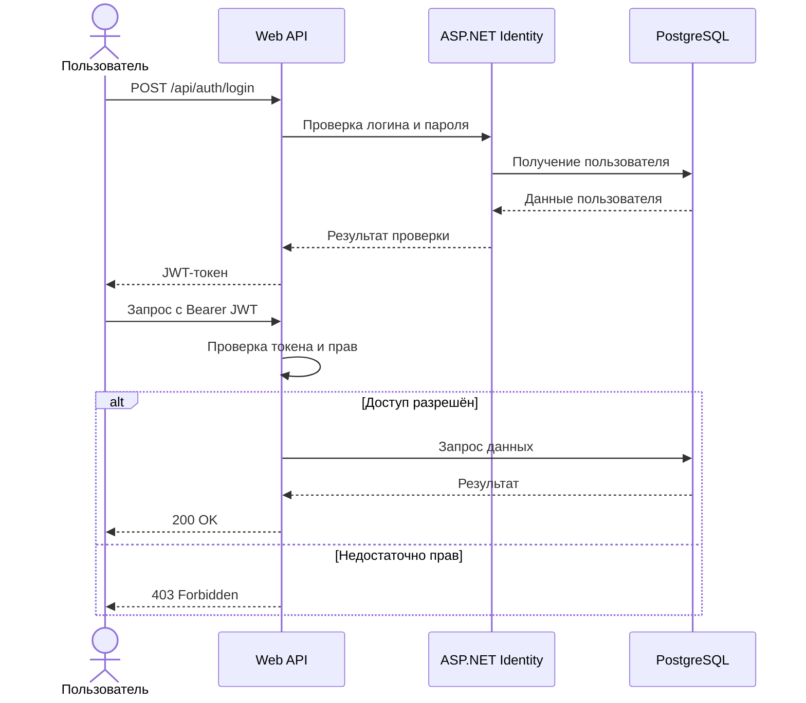

# University Course Management API

## 1. Описание проекта

В рамках задания разработана и расширена система управления университетскими курсами на ASP.NET Core (.NET 10) с использованием C# и PostgreSQL.

Система позволяет управлять студентами, преподавателями, курсами, записями на курсы и оценками. Во втором задании добавлены аутентификация, авторизация, разграничение доступа, версионирование API, MVC-клиент и автоматическое тестирование.

## 2. Реализованный функционал

**REST API и база данных**

Реализованы CRUD-операции для студентов, преподавателей, курсов и записей на курсы. Используются PostgreSQL, Entity Framework Core, миграции, репозитории, сервисы, DTO и единый формат ответов API.

**Аутентификация и безопасность**

Добавлены регистрация пользователей, вход по логину и паролю, выдача JWT-токена, проверка срока действия и подписи токена. Используется ASP.NET Core Identity с хешированием паролей и блокировкой после неудачных попыток входа.

**Роли и разграничение доступа**

Реализованы три роли:

- Admin: управление пользователями, ролями и данными системы.
- Teacher: просмотр записей и изменение оценок только на собственных курсах.
- Student: просмотр собственных записей и оценок без доступа к чужим данным.

Используются атрибуты Authorize, политики авторизации и проверки принадлежности ресурсов.

**CORS**

Настроена именованная политика `UniversityClients` с двумя разрешёнными адресами: `http://localhost:5200` и `http://localhost:5300`.

**MVC-клиент**

Создано отдельное ASP.NET Core MVC-приложение. Через `IHttpClientFactory` клиент получает список курсов и подробную информацию о них из основного API. Предусмотрена обработка ошибок HTTP и недоступности сервера.

**Версионирование API**

Реализованы следующие маршруты:

| Маршрут | Назначение |
|---|---|
| `/api/courses` | Исходный API |
| `/api/v1/courses` | Первая версия |
| `/api/v2/courses` | Вторая версия |

Версия v2 дополнительно возвращает имя преподавателя (`teacherName`) и количество записанных студентов (`studentCount`). Исходный API сохранён для обратной совместимости. Для v1 и v2 настроены отдельные Swagger-документы.

## 3. Проверка работы

Проведены ручные проверки через Swagger:

| Проверка | Результат |
|---|---|
| Доступ к собственным оценкам Student | 200 OK |
| Запрет просмотра чужих оценок Student | 403 Forbidden |
| Изменение оценки на своём курсе Teacher | 200 OK |
| Запрет изменения чужой оценки Teacher | 403 Forbidden |
| Запрос без JWT к защищённому ресурсу | 401 Unauthorized |
| Работа политики CORS | 204 No Content |
| API v1 и v2 | 200 OK |
| Работа старого `/api/courses` | 200 OK |
| Отображение курсов в MVC-клиенте | Успешно |

## 4. Автоматические тесты

Создан проект `UniversityCourseManagementTests` с использованием xUnit.

Тесты проверяют аутентификацию, JWT, права ролей, доступ к оценкам, запреты неавторизованных действий и совместимость версий API.

**Результаты выполнения:**

- Всего тестов: 20
- Успешно: 20
- Ошибок: 0
- Пропущено: 0
- Время выполнения: 1,4 секунды

Все 20 автоматических тестов успешно пройдены на подготовленной учебной базе данных.

## 5. Структура решения

- `UniversityCourseManagementApi` - основной REST API, база данных, авторизация и Swagger.
- `UniversityCourseManagementClient` - отдельное MVC-приложение для просмотра курсов.
- `UniversityCourseManagementTests` - автоматические тесты.

### Схема архитектуры проекта



### Схема последовательности аутентификации и авторизации



## 6. Запуск проекта

Для запуска необходимы .NET 10 SDK и PostgreSQL.

Перед запуском требуется настроить строку подключения к базе данных и параметры JWT через User Secrets, а также применить миграции Entity Framework Core. Для автоматических тестов необходимы подготовленные тестовые пользователи и записи.

**Запуск API:**

```powershell
dotnet run --project .\UniversityCourseManagementApi
```

Swagger: `http://localhost:5132/swagger`

**Запуск MVC-клиента в отдельном терминале:**

```powershell
dotnet run --project .\UniversityCourseManagementClient --urls "http://localhost:5200"
```

MVC-клиент: `http://localhost:5200/Courses`

**Запуск автоматических тестов:**

```powershell
dotnet test .\UniversityCourseManagementTests\UniversityCourseManagementTests.csproj
```

Для тестов основной API должен быть запущен. Необходимо заранее установить переменные окружения `TEST_API_URL`, данные тестовых пользователей и идентификаторы записей.

## 7. Итог

В ходе выполнения задания 2 расширен существующий REST API. Реализованы JWT-аутентификация, Identity, роли пользователей, защита ресурсов, CORS, MVC-клиент и версионирование API.

Работоспособность подтверждена ручными проверками в Swagger и успешным выполнением 20 автоматических тестов. Исходный код API, MVC-клиента и тестов размещён в GitHub.

**Репозиторий:** https://github.com/nynforeva/UniversityCourseManagementApi/tree/assignment-2
