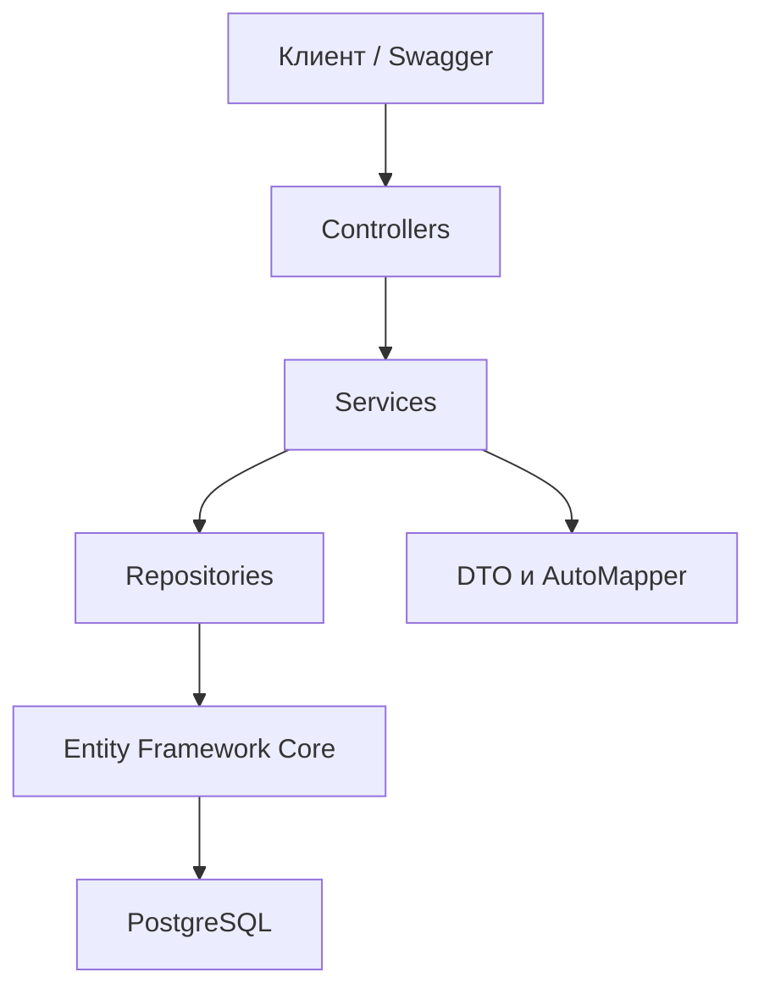

# Архитектура University Course Management API

В ходе практической работы я реализовала многослойную архитектуру REST API на ASP.NET Core.

## Схема архитектуры

## Описание компонентов

1. **Controllers** — принимают HTTP-запросы от клиента и возвращают ответы.
2. **Services** — отвечают за основную логику приложения и проверку данных.
3. **Repositories** — используются для получения, добавления, изменения и удаления данных.
4. **Entity Framework Core** — обеспечивает взаимодействие приложения с базой данных.
5. **PostgreSQL** — используется для хранения информации о студентах, преподавателях, курсах и записях на курсы.
6. **DTO и AutoMapper** — используются для передачи данных и преобразования объектов.

Для связи компонентов между собой я использовала Dependency Injection.

Также в проекте реализованы обработка ошибок через Middleware, логирование с помощью ILogger и единый формат ответов `ReturnResult<T>`.
